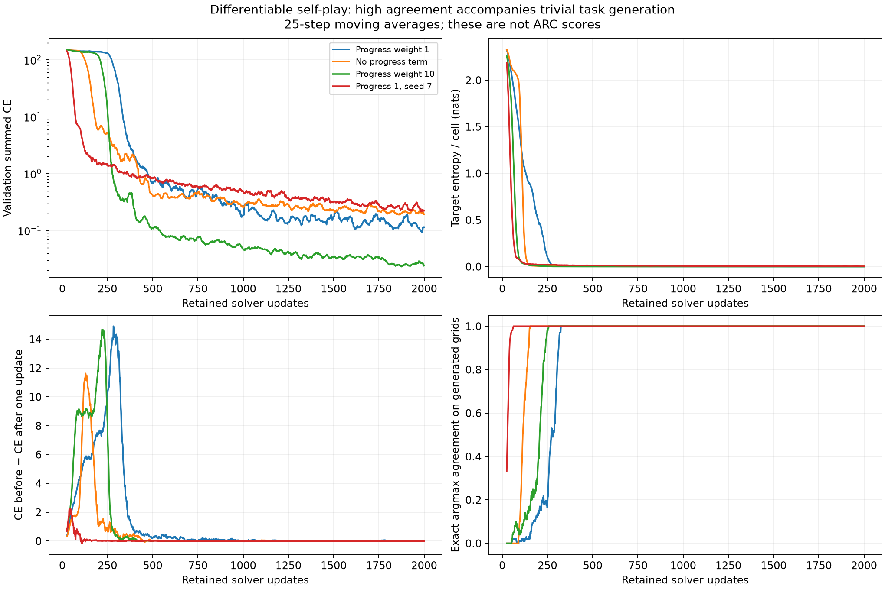
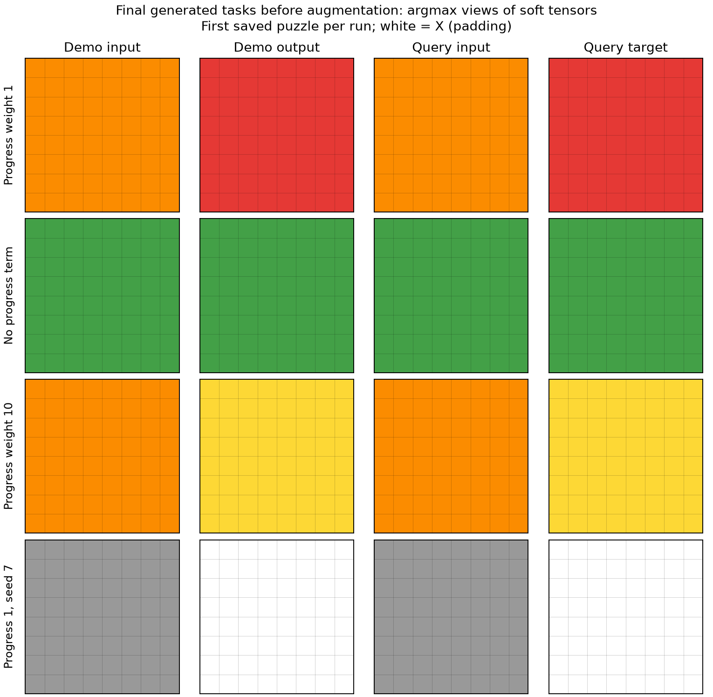

# Pilot results: differentiable ARC self-play

Date: 2026-10-09.

The three-network system runs end to end, with checked gradients through retained solver updates. The tested self-play configurations learn a trivial generated distribution. High generated-grid agreement does not demonstrate ARC reasoning. No external dataset was used for training and no official ARC score was measured.

## Matched A10 experiments

8×8, three demonstrations, four puzzle IDs, two adaptation and two fresh validation episodes per ID, one retained solver SGD update per iteration. All settings other than progress weight or the labeled seed match.

| Run | Steps | Final 20 mean CE | Final 20 grid agreement | Unique raw inputs / outputs in final batch | Discrete probe grids solved |
|---|---:|---:|---:|---:|---:|
| Progress weight 1 | 2000 | 0.1225 | 100.0% | 1 / 1 (of 64) | 0.0% |
| No progress term | 2000 | 0.1986 | 100.0% | 1 / 1 (of 64) | 0.0% |
| Progress weight 10 | 2000 | 0.0251 | 100.0% | 1 / 1 (of 64) | 0.0% |
| Progress 1, seed 7 | 2000 | 0.2303 | 100.0% | 1 / 1 (of 64) | 0.0% |

Diversity counts use unaugmented boards. Color permutations can make a constant-board generator look diverse in augmented batches. The sample audit also records confidence and continuous within-puzzle variance. The exact-agreement metric compares argmax predictions with argmax synthetic targets; it is not exp(-soft CE).

## Frozen tasks and transfer probes

The fixed task set is sampled from the generator at initialization and never used in adaptation or replay. The discrete probes are hand-written identity, cyclic recoloring, reflection and rotation families, with 16 total queries. They are evaluation only. These tiny synthetic checks are not a substitute for ARC evaluation.

| Run | Frozen-task CE before → after | Discrete probe cell accuracy | Discrete probe grid accuracy |
|---|---:|---:|---:|
| Progress weight 1 | 153.83 → 158.48 | 22.5% | 0.0% |
| No progress term | 153.83 → 156.78 | 30.4% | 0.0% |
| Progress weight 10 | 153.83 → 153.45 | 23.3% | 0.0% |
| Progress 1, seed 7 | 154.38 → 153.30 | 4.3% | 0.0% |

## Separate supervised controls

These controls start fresh solvers; their examples and weights never enter the self-play runs. Recoloring uses a different cyclic color shift per puzzle, so the solver must use demonstrations to select the rule.

| Control | Updates | Held-out queries | Exact grids | Cell accuracy with mismatched supports |
|---|---:|---:|---:|---:|
| identity | 500 | 64 | 100.0% | 100.0% |
| recolor | 10000 | 64 | 96.9% | 25.9% |

## Hardware measurements

Same model, batch size and fixed update count within each canvas comparison; the first five steps are excluded from steady throughput. These small FP32 eager workloads are not representative of a scaled model. TF32 is enabled, and higher-order derivatives use explicit attention matmuls.

| GPU | Canvas | Steps | Steady steps/sec | Peak allocated GPU GiB | Estimated $ / 1,000 steps |
|---|---:|---:|---:|---:|---:|
| A10 | 8×8 | 400 | 25.52 | 0.043 | $0.0137 |
| L40S | 8×8 | 400 | 24.74 | 0.043 | $0.0237 |
| A10 | 30×30 | 200 | 21.51 | 0.324 | $0.0163 |
| L40S | 30×30 | 200 | 28.95 | 0.324 | $0.0202 |

Cost estimates use the [Modal price list](https://modal.com/pricing) checked on 2026-10-09: GPU plus two CPU cores and 8 GiB host RAM, excluding startup, builds and artifact handling. This is a throughput comparison, not a billing statement.

The persistent budget ledger allocates **$9.22 of the $20 ceiling**, including full timeout reservations for failed attempts and a $2 miscellaneous reserve. Recorded worker-time estimates sum to $0.20; applying conservative GPU-plus-host rates to recorded local job wall times gives $0.39. The latter also counts periods spent building, queuing or downloading, so it overcounts active GPU time. Neither number is an invoice. Early worker timers exclude archive packaging; the allocation covers that overhead.

## Verification and limitations

- All 24 local tests pass. Numerical finite-difference gradients match for both generators through a real solver update. Stopping the update derivative changes the gradient.
- Tests verify committed SGD weights, historical replay reconstruction, support-order invariance, consistent augmentation, exact CPU checkpoint continuation, ARC rectangle decoding and budget enforcement.
- 30×30 training and CUDA second derivatives execute successfully. The small pilots do not test long-run stability at scale.
- Training never discretizes boards. The almost one-hot distributions observed in some runs emerge from optimization.
- Soft X occupancy is unconstrained during generation; rectangular validity is imposed only by the optional ARC evaluator's output decoder.
- No H100s, pretrained weights, external training corpora, or autonomous recurring jobs are used.
- A failed initial Modal download/build and artifact-transfer corruption were recovered without rerunning completed training. Downloads now check SHA-256 and ZIP integrity and retry the download only.

## Interpretation

These runs establish that the proposed differentiable mechanism can be implemented and trained cheaply at pilot scale. They do not establish useful open-ended exploration. Under these tested settings, the current learning-progress objective does not keep the task generators from converging on trivial rules. Increasing compute alone is not the next experiment suggested by this evidence.

A useful next experiment would preserve soft boards while rewarding improvement on a persistent, diverse held-out task bank, and explicitly measuring novelty beyond color permutations. That would change the objective and has not been silently added here. Architecture and timescale choices also remain open: one SGD step measures very short-term progress, and this compact transformation family is deliberately limited.

## Artifacts

- [Implementation and commands](../README.md)
- [Raw diversity audit](sample-audit.json)
- [Budget ledger](../budget-ledger.json)
- Per-run configs, full JSONL histories, summaries, generated tensors, frozen task sets and resumable checkpoints are in `../runs/`.
- Regenerate this report with `python make_report.py` after installing matplotlib.
