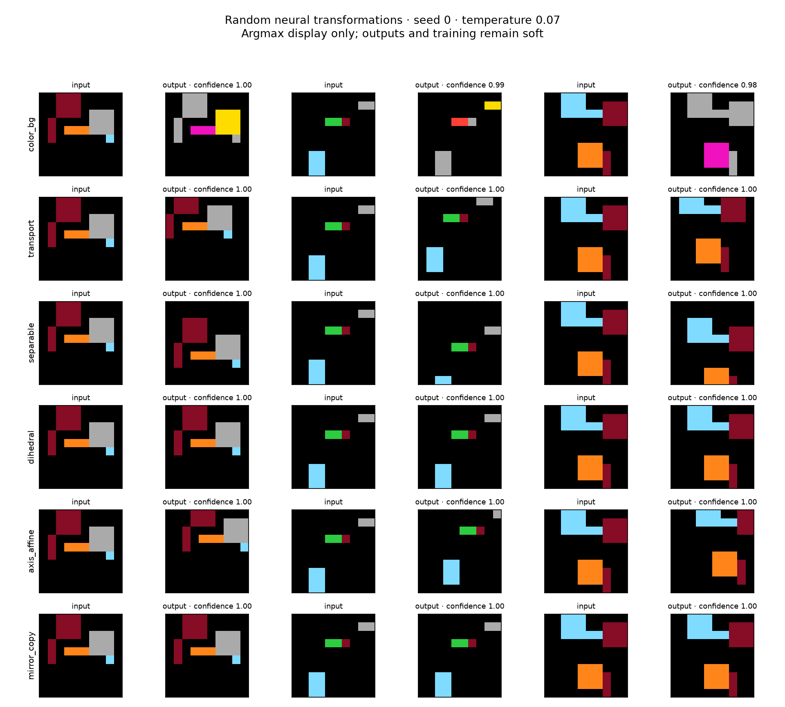
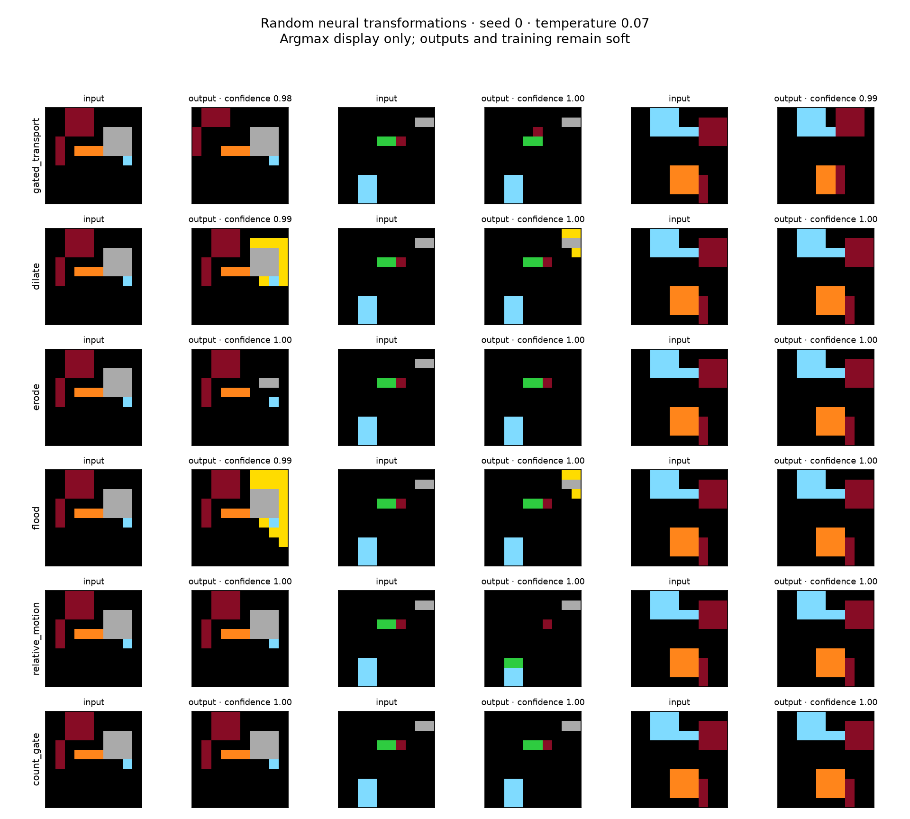
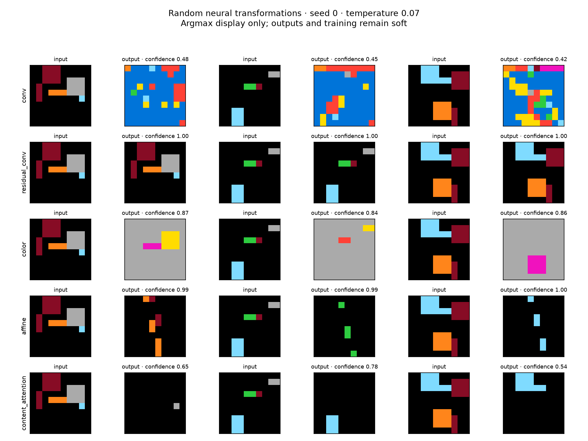
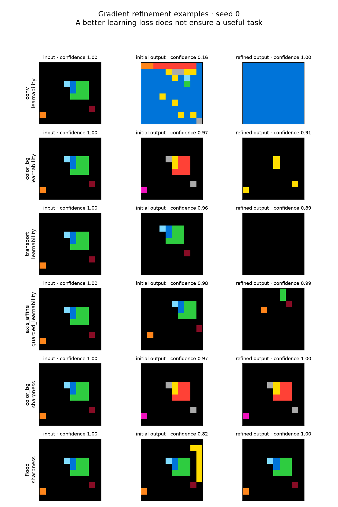

# XP002 — Random neural transformation primitives

Run date: 2026-10-12. No external data, pretrained weights, or official ARC evaluation.
All experiments ran locally on CPU; **additional cloud spending: $0**.

## Findings

Random initialization can produce coherent tasks when the neural architecture gives its weights shared spatial or color meanings. This is strong evidence for structured neural task families, not for arbitrary random neural networks as ARC generators. The tested operations are architectural priors; sampling a rotation from a dihedral module does not discover rotation.

Local exploration mostly preserves those families. Gradient refinement is feasible and numerically checked, but optimizing short-horizon learnability frequently rewards collapse or softening. The existing in-context solver also struggles with several tasks that a matched-family inverse learner solves readily.

Inspect the [interactive gallery](xp002-gallery.html), [aggregate JSON](xp002-summary.json), and [initialization heatmap](xp002-screening.png). The gallery includes uncertain outputs and failures as well as useful examples. It shows all first-three-seed examples collected, not just selected successes.

## Scope and protocols

- **17 architectures, 1,224 random initializations**, 24 seeds × three temperatures, plus 68 full 30×30 audits. Random weights only; no hypernetwork. Each task uses one fixed transformation across its instances.
- **6,120 exploration candidates**, including restart, perturbation, related/unrelated weight interpolation, two- and three-stage composition, and gated composition. This count includes unchanged-parent controls.
- **204 base inverse-learning tasks**, 12 teacher seeds/family; 3 fixed demonstrations, 32 independent object-board queries, 16 IID queries, and 8 full-size queries. Two fresh student initializations, 300 Adam steps each. Best restart is selected using demonstration loss only.
- 48 optimizer follow-ups, 144 coverage controls, **408 transformation-refinement runs**, and **204 input-optimization runs**. See the inventory for smoke runs and all training steps.
- Neural solver controls use the existing 43,115-parameter solver, three demos, 8×8 grids, and 10,000 updates/run. Test transformation seeds are disjoint from training seeds. These are synthetic generalization checks, not ARC scores.
- Inputs: synthetic rectangles, lines and dots on black backgrounds; separate IID controls. Ten real colors plus X, which is unused on these full square canvases. Targets stay soft; argmax is only for diagnostics and pictures. Input-board optimization also stays soft.
- Deliberate omissions: variable output sizes, rectangular padding, connected-component segmentation, object identity across disconnected same-color regions, arbitrary counting, multi-step symbolic rule discovery, and official ARC transfer.

The structural screen requires active-cell confidence > .85, >5% changed cells, cross-input output variation > .02, and nonuniform outputs on >75% of boards. **It is only a heuristic.** Sparse useful edits can fail the 5% rule, and a destructive geometric warp can pass. Active cells are the union of input/output argmax foreground. Mean confidence alone is inflated by background. Exact-grid accuracy below compares argmax outputs; soft KL is recorded separately.

## Initializations and three-demo inverse fitting

| Family | Params | Sharp screen pass | Active confidence | Changed cells | 3-demo exact queries | Identity exact |
| --- | --- | --- | --- | --- | --- | --- |
| conv | 4570 | 0.0% | 40.9% | 95.6% | 0.0% | 0.0% |
| residual_conv | 4570 | 0.0% | 100.0% | 0.0% | 0.3% | 100.0% |
| color | 100 | 87.5% | 94.8% | 95.1% | 30.2% | 0.0% |
| color_bg | 100 | 100.0% | 93.4% | 10.5% | 30.2% | 0.0% |
| transport | 25 | 66.7% | 92.3% | 17.0% | 100.0% | 0.0% |
| separable | 10 | 75.0% | 91.7% | 16.1% | 100.0% | 8.3% |
| dihedral | 8 | 79.2% | 95.2% | 19.0% | 100.0% | 16.7% |
| affine | 6 | 91.7% | 99.3% | 20.1% | 13.8% | 0.0% |
| axis_affine | 6 | 95.8% | 99.0% | 18.6% | 40.6% | 0.8% |
| content_attention | 160 | 0.0% | 73.4% | 17.9% | 34.9% | 0.0% |
| gated_transport | 34 | 0.0% | 97.0% | 1.8% | 96.1% | 54.7% |
| dilate | 27 | 0.0% | 97.8% | 2.3% | 75.5% | 57.6% |
| erode | 18 | 0.0% | 98.5% | 1.3% | 76.6% | 57.6% |
| flood | 27 | 75.0% | 93.8% | 14.4% | 54.4% | 46.4% |
| relative_motion | 20 | 0.0% | 97.4% | 1.8% | 54.2% | 64.6% |
| count_gate | 20 | 0.0% | 99.6% | 0.4% | 95.1% | 97.1% |
| mirror_copy | 8 | 83.3% | 97.6% | 9.0% | 100.0% | 16.7% |

The three-demo column gives the learner the correct architecture family. It does **not** give it the teacher weights or query labels. This measures parameter identifiability and optimization within a family, not unknown-family inference or the existing solver's capability. The last column copies the query input unchanged. Low-temperature shared routing is particularly successful. Plain convolutions have diffuse random outputs; a strong residual identity bias produces mostly identity.

**Sparse conditional rules need the identity control.** Selected-color transport's 96.1% exceeds its 54.7% identity baseline. But relative movement's 54.2% is below its 64.6% identity baseline, and count-gate's 95.1% is below 97.1% identity. Those two inference results are failures; visually interesting occasional outputs do not establish a useful task distribution. This input prior rarely activates the count threshold. Morphology/propagation also have substantial identity fractions, so their raw exact accuracies overstate the difficulty solved.







Architectural details: color maps are column-softmax matrices; transport is a shared convex mixture of 25 spatial offsets; separable routing factors row/column offsets; dihedral routing mixes eight fixed symmetries. Affine models use Gaussian coordinate attention; axis-affine starts near signed diagonal matrices, but all entries are trainable. Content attention pools raw color values. Gated transport moves a soft color-selected mask. Morphology uses learned neighbor gates with soft probabilistic union/intersection. Flood uses four recurrent local expansion steps through background, with other colors acting as barriers. Relative motion translates a selected color mask toward another color's centroid; it is not general object segmentation. Count-gate thresholds selected-color **area fraction**, not an abstract size-independent count. Mirror-copy places transformed foreground into background only. Those semantics are supplied by the architecture.

### Optimization and demonstration coverage controls

The initial uniform learning rate (.06) was unsuitable for convolutional inverse learners and some coordinate models. A follow-up used .003, 600 steps, and four restarts; all three changes are confounded, so this only establishes whether a stronger fitting attempt helps.

| Family | Demonstration KL: base → follow-up | Query exact: base → follow-up |
| --- | --- | --- |
| conv | 15.715 → 0.000 | 0.0% → 0.0% |
| residual_conv | 0.507 → 0.000 | 0.3% → 48.7% |
| affine | 0.909 → 1.213 | 13.8% → 8.6% |
| axis_affine | 0.625 → 0.262 | 40.6% → 63.0% |

The three object demonstrations contain colors 0,1,2,4,5,6,7,9; **3 and 8 are absent**. Their mapping cannot be recovered from those demonstrations. Eight object demos cover all real colors. Three IID demos also cover colors but can be poor evidence for sparse propagation behavior.

| Family | 3 object demos | 8 object demos | 3 IID demos |
| --- | --- | --- | --- |
| color | 30.2% | 100.0% | 100.0% |
| color_bg | 30.2% | 100.0% | 100.0% |
| gated_transport | 96.1% | 100.0% | 100.0% |
| dilate | 75.5% | 100.0% | 81.8% |
| erode | 76.6% | 97.9% | 95.3% |
| flood | 54.4% | 91.9% | 64.1% |

This is evidence that the board distribution controls identifiability, independently of the transformation being simple.

## Exploration

These rates are conditioned on the unchanged parent passing the screen on an independent probe set. Distance is mean per-cell total variation between the parent's and child's soft outputs. High preservation with near-zero distance is not broad exploration.

| Proposal | Passing parents | Child screen pass | Mean output distance |
| --- | --- | --- | --- |
| parent | 182 | 100.0% | 0.000 |
| random_restart | 182 | 83.5% | 0.244 |
| noise_0.1 | 182 | 92.9% | 0.032 |
| noise_0.5 | 182 | 86.8% | 0.099 |
| noise_2.0 | 182 | 76.4% | 0.179 |
| interpolate_unrelated_0.25 | 182 | 85.2% | 0.086 |
| interpolate_unrelated_0.5 | 182 | 78.6% | 0.165 |
| interpolate_unrelated_0.75 | 182 | 78.0% | 0.221 |
| interpolate_sibling_0.25 | 182 | 96.7% | 0.022 |
| interpolate_sibling_0.5 | 182 | 96.2% | 0.039 |
| interpolate_sibling_0.75 | 182 | 92.3% | 0.055 |
| compose_same | 182 | 80.8% | 0.215 |
| compose_color | 182 | 89.0% | 0.202 |
| gated_color_0.2 | 182 | 52.7% | 0.040 |
| compose_depth3 | 182 | 72.5% | 0.262 |

Small perturbations and related interpolation preserve structure more reliably. Deeper composition can erase information. Gated composition often lowers crispness because it mixes two different color distributions; failing this screen is not evidence that its gradients cannot be useful. Semantic parameter coordinates make interpolation more meaningful than arbitrary hidden-unit averaging.

## Differentiable refinement

Start from temperature .3 and optimize the transformation weights for 100 Adam steps (.03 learning rate), eight seeds per family. Each outer step uses new procedural support/query boards. The diagnostic student is a small two-layer convolutional network trained on three examples with five differentiable SGD steps (per-cell CE, learning rate .8); it is reset to a new initialization each outer step. Final measurements use 24 held-out queries and three fresh student seeds. This diagnostic is **not the original progress self-play objective**, and is not a trained universal solver.

Objectives: (1) minimize target entropy; (2) minimize the fresh learner's post-adaptation soft KL; (3) that KL plus .2×entropy and squared hinge penalties for low output response, low spatial variance, and too little change from input. See source for the exact constants. These hand-designed guards are tested hypotheses, not guarantees of meaningfulness. No accuracy claim is made from training loss alone.

| Family | Objective | Fresh learner KL: before → after | Screen: before → after |
| --- | --- | --- | --- |
| conv | sharpness | 0.039 → 0.001 | 0.0% → 0.0% |
| conv | learnability | 0.039 → 0.002 | 0.0% → 0.0% |
| conv | guarded_learnability | 0.039 → 0.002 | 0.0% → 0.0% |
| residual_conv | sharpness | 0.871 → 0.013 | 0.0% → 0.0% |
| residual_conv | learnability | 0.871 → 0.003 | 0.0% → 0.0% |
| residual_conv | guarded_learnability | 0.871 → 0.003 | 0.0% → 0.0% |
| color | sharpness | 5.165 → 1.586 | 37.5% → 100.0% |
| color | learnability | 5.165 → 0.278 | 37.5% → 37.5% |
| color | guarded_learnability | 5.165 → 0.392 | 37.5% → 37.5% |
| color_bg | sharpness | 1.249 → 1.408 | 0.0% → 100.0% |
| color_bg | learnability | 1.249 → 0.380 | 0.0% → 0.0% |
| color_bg | guarded_learnability | 1.249 → 0.485 | 0.0% → 0.0% |
| transport | sharpness | 1.270 → 1.258 | 37.5% → 100.0% |
| transport | learnability | 1.270 → 1.076 | 37.5% → 0.0% |
| transport | guarded_learnability | 1.270 → 1.067 | 37.5% → 0.0% |
| separable | sharpness | 1.358 → 1.490 | 62.5% → 87.5% |
| separable | learnability | 1.358 → 1.065 | 62.5% → 0.0% |
| separable | guarded_learnability | 1.358 → 1.047 | 62.5% → 0.0% |
| dihedral | sharpness | 0.967 → 1.144 | 37.5% → 75.0% |
| dihedral | learnability | 0.967 → 0.690 | 37.5% → 0.0% |
| dihedral | guarded_learnability | 0.967 → 0.734 | 37.5% → 0.0% |
| affine | sharpness | 1.265 → 0.617 | 100.0% → 100.0% |
| affine | learnability | 1.265 → 0.666 | 100.0% → 75.0% |
| affine | guarded_learnability | 1.265 → 0.421 | 100.0% → 100.0% |
| axis_affine | sharpness | 1.541 → 1.335 | 100.0% → 100.0% |
| axis_affine | learnability | 1.541 → 0.330 | 100.0% → 100.0% |
| axis_affine | guarded_learnability | 1.541 → 0.311 | 100.0% → 100.0% |
| content_attention | sharpness | 0.908 → 0.003 | 0.0% → 0.0% |
| content_attention | learnability | 0.908 → 0.044 | 0.0% → 0.0% |
| content_attention | guarded_learnability | 0.908 → 0.022 | 0.0% → 0.0% |
| gated_transport | sharpness | 1.196 → 1.401 | 0.0% → 0.0% |
| gated_transport | learnability | 1.196 → 0.984 | 0.0% → 0.0% |
| gated_transport | guarded_learnability | 1.196 → 0.987 | 0.0% → 0.0% |
| dilate | sharpness | 1.279 → 1.209 | 0.0% → 0.0% |
| dilate | learnability | 1.279 → 1.155 | 0.0% → 0.0% |
| dilate | guarded_learnability | 1.279 → 1.149 | 0.0% → 0.0% |
| erode | sharpness | 1.305 → 1.057 | 0.0% → 0.0% |
| erode | learnability | 1.305 → 1.268 | 0.0% → 0.0% |
| erode | guarded_learnability | 1.305 → 1.193 | 0.0% → 0.0% |
| flood | sharpness | 6.411 → 5.945 | 25.0% → 62.5% |
| flood | learnability | 6.411 → 3.535 | 25.0% → 12.5% |
| flood | guarded_learnability | 6.411 → 4.051 | 25.0% → 25.0% |
| relative_motion | sharpness | 1.162 → 1.454 | 0.0% → 0.0% |
| relative_motion | learnability | 1.162 → 1.035 | 0.0% → 0.0% |
| relative_motion | guarded_learnability | 1.162 → 1.190 | 0.0% → 0.0% |
| count_gate | sharpness | 1.561 → 1.566 | 0.0% → 0.0% |
| count_gate | learnability | 1.561 → 1.506 | 0.0% → 0.0% |
| count_gate | guarded_learnability | 1.561 → 1.507 | 0.0% → 0.0% |
| mirror_copy | sharpness | 8.336 → 9.558 | 50.0% → 75.0% |
| mirror_copy | learnability | 8.336 → 3.689 | 50.0% → 12.5% |
| mirror_copy | guarded_learnability | 8.336 → 3.590 | 50.0% → 12.5% |



Read KL reductions alongside confidence and diversity: making the target constant or broad can make it easier to match. Sharpening is effective in some structured families, but cannot turn an unconstrained network into a useful family by itself. The guards tested here are insufficient to reliably prevent degeneracy. Positive affine results also need caution: easy geometric distortion is not necessarily an ARC-like semantic rule.

### Gradient sensitivity

Fraction of initializations with parameter-gradient norm < 1e-6 under a fixed random linear output probe (not the learning objective). This is a local sensitivity diagnostic, not a guarantee of useful gradients.

| Family | T=1 | T=.3 | T=.07 |
| --- | --- | --- | --- |
| conv | 0.0% | 0.0% | 0.0% |
| residual_conv | 0.0% | 0.0% | 100.0% |
| color | 0.0% | 0.0% | 0.0% |
| color_bg | 0.0% | 0.0% | 0.0% |
| transport | 0.0% | 0.0% | 16.7% |
| separable | 0.0% | 0.0% | 16.7% |
| dihedral | 0.0% | 0.0% | 33.3% |
| affine | 0.0% | 0.0% | 0.0% |
| axis_affine | 0.0% | 0.0% | 8.3% |
| content_attention | 0.0% | 0.0% | 0.0% |
| gated_transport | 0.0% | 0.0% | 8.3% |
| dilate | 0.0% | 0.0% | 0.0% |
| erode | 0.0% | 0.0% | 8.3% |
| flood | 0.0% | 0.0% | 0.0% |
| relative_motion | 0.0% | 0.0% | 0.0% |
| count_gate | 0.0% | 41.7% | 58.3% |
| mirror_copy | 0.0% | 0.0% | 33.3% |

## Optimizing input boards

Hold the random transformation fixed. Optimize eight soft input-board logits for 100 steps, rewarding output/input change and cross-board output variation, penalizing input entropy and changes in foreground occupancy. Initialization comes from structured boards. This is input search, not learned task generation, and can create irregular patterns. It does not guarantee demonstrations that identify the rule.

| Family | Changed cells: before → after | Final input confidence | Screen: before → after |
| --- | --- | --- | --- |
| conv | 96.6% → 96.7% | 100.0% | 0.0% → 0.0% |
| residual_conv | 0.0% → 0.0% | 100.0% | 0.0% → 0.0% |
| color | 91.4% → 91.4% | 100.0% | 83.3% → 83.3% |
| color_bg | 9.9% → 9.9% | 100.0% | 100.0% → 100.0% |
| transport | 16.9% → 19.0% | 100.0% | 75.0% → 91.7% |
| separable | 15.8% → 20.5% | 100.0% | 58.3% → 91.7% |
| dihedral | 16.0% → 16.0% | 100.0% | 75.0% → 75.0% |
| affine | 19.7% → 20.3% | 100.0% | 100.0% → 100.0% |
| axis_affine | 16.2% → 16.7% | 100.0% | 91.7% → 91.7% |
| content_attention | 18.8% → 34.5% | 99.2% | 0.0% → 0.0% |
| gated_transport | 1.5% → 1.5% | 100.0% | 0.0% → 0.0% |
| dilate | 2.6% → 3.9% | 100.0% | 0.0% → 8.3% |
| erode | 1.1% → 1.1% | 100.0% | 0.0% → 0.0% |
| flood | 16.0% → 78.8% | 99.7% | 75.0% → 75.0% |
| relative_motion | 1.9% → 2.0% | 99.9% | 0.0% → 0.0% |
| count_gate | 0.3% → 0.6% | 100.0% | 0.0% → 0.0% |
| mirror_copy | 7.5% → 7.8% | 100.0% | 83.3% → 83.3% |

## Existing solver controls

The solver receives only demonstrations and the query. Single-family runs train on 32 random transformation seeds; mixed runs train on 128 (32 each for color_bg, transport, dihedral, flood). Each family is evaluated on 16 unseen transformation seeds × four queries. Mismatched-demo controls replace whole coherent demonstration sets with another task's demonstrations. Balanced cell accuracy averages over target colors present in the evaluation set, reducing background dominance.

| Run | Test family | Exact queries | Balanced cells | Wrong-demo exact | Identity exact |
| --- | --- | --- | --- | --- | --- |
| color | color_bg | 39.1% | 80.3% | 0.0% | 0.0% |
| dihedral | dihedral | 0.0% | 10.0% | 1.6% | 0.0% |
| mixed | color_bg | 14.1% | 58.8% | 0.0% | 0.0% |
| mixed | transport | 6.2% | 12.9% | 4.7% | 0.0% |
| mixed | dihedral | 1.6% | 10.7% | 1.6% | 0.0% |
| mixed | flood | 37.5% | 52.3% | 37.5% | 53.1% |
| mixed29 | color_bg | 10.9% | 57.2% | 0.0% | 0.0% |
| mixed29 | transport | 6.2% | 10.7% | 6.2% | 0.0% |
| mixed29 | dihedral | 1.6% | 10.6% | 3.1% | 0.0% |
| mixed29 | flood | 45.3% | 50.2% | 43.8% | 53.1% |
| transport | transport | 34.4% | 69.4% | 0.0% | 0.0% |

The oracle-family inverse learner and this in-context solver are different inference mechanisms. A gap between them is evidence of a limitation in this solver/training setup, not proof that the tasks are intrinsically unlearnable. Single-family controls help separate mixed-task interference from basic inference difficulty. The 3-demo color coverage ceiling and soft-label uncertainty still apply.

## Reproduction and run inventory

Run from the repository with its existing Python environment:

```sh
python -m pytest -q
python -m arcplay.primitive_experiments audit --output runs/new-audit
python -m arcplay.primitive_experiments explore --seeds 24 --output runs/new-explore
python -m arcplay.primitive_experiments infer --seeds 12 --steps 300 --output runs/new-infer
python -m arcplay.primitive_experiments refine --seeds 8 --steps 100 --output runs/new-refine
python -m arcplay.primitive_followups coverage --output runs/new-coverage
python -m arcplay.primitive_followups optimize_inputs --output runs/new-inputs
python -m arcplay.primitive_followups gradients --output runs/new-gradients
python -m arcplay.primitive_followups solver --regime mixed --steps 10000 --output runs/new-solver
python make_primitive_report.py
```

The original sweep had 14 families; relative_motion, count_gate and mirror_copy were follow-ups. Current default commands include all 17. Run folders contain configurations, raw JSON and examples. Early core-experiment source snapshots were captured before adding the three later families; later launches record source snapshots and hashes automatically. Fixed seeds reproduce inputs and initialization within this environment. Fitting uses soft targets and selects restarts on support only. Early smoke runs and the high-learning-rate failure are retained. `runs/` is Git-ignored; report artifacts outside it provide aggregate results and the visual gallery.

Verification: **44 tests passed**, including probability conservation and first/second derivatives for all 17 architectures, routing boundaries, rejection of constant/identity tasks by the diagnostic screen, and a finite-difference check through student updates. See [test output](xp002-tests.txt). All 1,224 initialization outputs passed the probability-validity checks. Static figures were visually inspected. Automatic browser review blocked the optional HTML gallery preview because the browser does not permit local `file:` URLs; the self-contained gallery is saved but was not browser-tested.

| Run | Elapsed seconds | Work |
| --- | --- | --- |
| xp002-audit | 1.2 | {"tasks": 1008, "full_size_tasks": 56} |
| xp002-audit-object | 0.3 | {"tasks": 216, "full_size_tasks": 12} |
| xp002-coverage | 42.0 | {"tasks": 144, "updates": 86400} |
| xp002-explore | 5.6 | {"candidates": 5040} |
| xp002-explore-object | 1.4 | {"candidates": 1080} |
| xp002-gradients | 0.3 | {"tasks": 612} |
| xp002-infer | 37.4 | {"tasks": 168, "updates": 100800} |
| xp002-infer-calibrated | 49.5 | {"tasks": 48, "updates": 115200} |
| xp002-infer-object | 9.6 | {"tasks": 36, "updates": 21600} |
| xp002-infer-smoke | 0.9 | {"tasks": 4, "updates": 800} |
| xp002-inputs | 12.7 | {"tasks": 168, "updates": 16800} |
| xp002-inputs-object | 2.6 | {"tasks": 36, "updates": 3600} |
| xp002-refine | 116.8 | {"tasks": 336, "outer_updates": 33600} |
| xp002-refine-object | 38.9 | {"tasks": 72, "outer_updates": 7200} |
| xp002-refine-smoke | 0.7 | {"tasks": 6, "outer_updates": 120} |
| xp002-solver-color | 80.0 | {"updates": 10000} |
| xp002-solver-dihedral | 79.7 | {"updates": 10000} |
| xp002-solver-mixed | 66.6 | {"updates": 10000} |
| xp002-solver-mixed29 | 86.7 | {"updates": 10000} |
| xp002-solver-transport | 87.5 | {"updates": 10000} |

Additional cloud spend is zero; no Modal workers or schedules were launched. Elapsed times above are per-process wall times and overlap across concurrently running local experiments. This is a broad, finite architecture sweep, not an exhaustion of all possible neural inductive biases.
