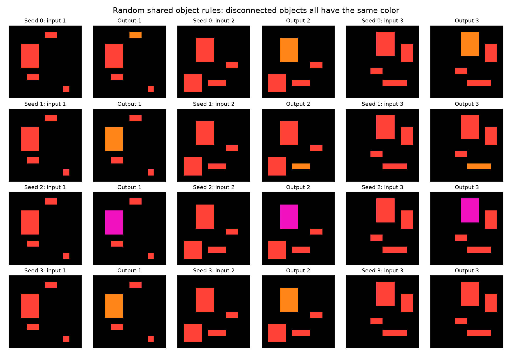
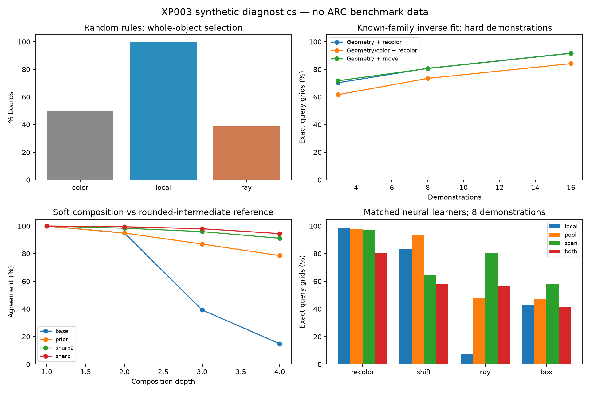
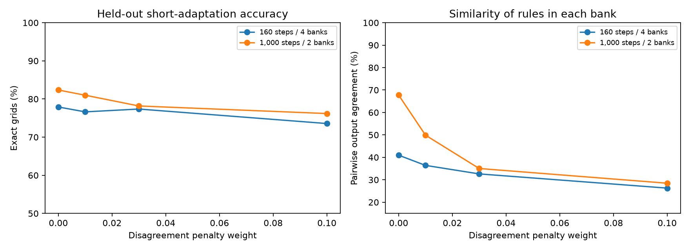

# XP003 — Object representations, neural task refinement, and CompressARC-inspired layers

**Synthetic research experiment. No ARC examples, external training data, pretrained weights, or cloud compute.**
All reported inference percentages are on generated tasks, not ARC benchmark scores.

## Findings

1. A connectivity prior plus pooled object features gives random weights a useful task family. On the audited separated monochrome boards, geometry-only selectors at temperature 0.03 selected one complete object in all tested cases, including repeated colors and 30×30 canvases. Color masks and endpoint-gated ray scans do not provide equivalent object representations.
2. The family is learnable from a few demonstrations, but remains ambiguous. Three hard examples give about 70% exact new-board agreement for random geometry/recolor rules; sixteen give about 92%. The learner is explicitly supplied the correct architecture family, and these are per-task fits, not the existing in-context solver.
3. Differentiating through a short learner adaptation improves held-out learnability in this restricted family. The improvement replicates on new teacher and board seeds. Diversity measurements below show what remains of the rule bank.
4. Soft composition has a real numerical/representational problem. A differentiable power transform before region construction improves stability. Fourth-power sharpening severely weakens gradients that could change the regions through board logits; square-power sharpening is a better candidate for further study, but also attenuates them.
5. CompressARC-inspired cumulative scans help ray extension strongly. They do not substitute for object representations in selection tasks, and combining every layer is not uniformly better.




## What was built, and what is an explicit prior

Each cell seeds a soft region. Four-neighbor recurrent max propagation is gated by color compatibility. On one-hot inputs this implements bounded same-color connectivity; it is not learned segmentation. All candidate masks remain real-valued. There is no connected-component labeling routine or symbolic rule interpreter in the forward pass. The synthetic instance IDs are used only for evaluation.

Each region supplies log area, centroid x/y, and x/y spread. The optional color-aware version adds nine pooled color channels. Features are standardized across candidate objects on each board. A shared random linear vector scores the candidates, and a softmax selects their weighted mask. The action recolors that mask or moves it one cell in a learned mixture of cardinal directions. Inputs use black and colors 1–3 (or distinct colors in controls); paint uses reserved colors 5–9, so identity is not the easy default.

Every object has multiple seeds. Subtracting log region area from candidate logits compensates for this multiplicity. Without it, larger objects get extra votes even when their scores are identical. This correction is exact for duplicate hard component masks and approximate for soft/partial regions.

Connectivity, foreground/background, coordinate moments, shared selection, and edit structure are **human-specified architectural priors**. Only scorer/action weights are randomly initialized in the main task-family experiment. This establishes a useful narrow neural parameterization, not discovery of an ARC prior from nothing. No edits were made to the original three-network self-play training loop.

## Data and segmentation audits

Default scenes contain four separated objects on 12×12 grids: rectangles, lines, and connected polyominoes. Train, query, irregular-shape, and 30×30 seeds are separate. Scene geometry and palette remain limited. Large canvases retain similarly small objects; this is not a large-object stress test.

The region audit uses 64 boards/regime (four boards for its initial 30×30 check). Color masks exactly cover only 28.5% of objects when colors repeat, and none when all four objects share a color. Local propagation with four or more steps offers at least one exact candidate for every object in these small-shape datasets. Full task transforms use 24 steps, so all seeds within each tested small object agree. These are distinct metrics: best-candidate coverage is weaker than all-seed consistency.

The explicit winding-path control fails to converge from any seed in 24 steps; 144 steps recover the whole path from every seed. Finite propagation depth remains a limitation. Candidate storage is quadratic in cell count, with recurrent computation multiplying that cost, so this all-cell prototype needs a more economical seed mechanism before scaling.

A same-color prior fragments multicolored semantic objects. A foreground-connectivity alternative recovers separated multicolor shapes, but merges touching objects of different colors. In a follow-up 64-board audit, multicolor object coverage is 3.9% with same-color grouping versus 100% with foreground grouping; touching-object coverage is 100% versus 62.9%. Neither definition is universally the right object.

## Few-shot inverse learning

Each random teacher is fixed. An independently initialized student in the same family is fitted to 3, 8, or 16 demonstrations by gradient descent on grid distributions. Two Adam restarts, 400 steps/restart, learning rate 0.03; only support loss chooses the restart. Student temperature anneals 0.4→0.03. Results average 24 teacher seeds, each with 32 held-out rectangle queries and 32 irregular queries. No query enters fitting or restart selection.

Hard-target controls remove soft-label side information by converting the teacher output to one-hot targets **for this diagnostic only**. Soft labels do help, but do not explain all the transfer. Nearly perfect support fits alongside imperfect query fits expose underdetermination and/or inductive-bias mismatch.

| features | action | hard_targets | support_count | Support | Query | Irregular query |
|---|---|---|---|---|---|---|
| geometry | paint | False | 3 | 100.0% | 75.5% | 73.2% |
| geometry | paint | True | 3 | 100.0% | 70.3% | 68.2% |
| geometry | paint | True | 8 | 100.0% | 80.7% | 79.7% |
| geometry | paint | True | 16 | 99.7% | 91.7% | 92.1% |
| all | paint | False | 3 | 100.0% | 63.0% | 58.3% |
| all | paint | True | 3 | 100.0% | 61.7% | 59.8% |
| all | paint | True | 8 | 99.5% | 73.4% | 72.8% |
| all | paint | True | 16 | 99.7% | 84.1% | 85.9% |
| geometry | move | False | 3 | 100.0% | 74.5% | 71.4% |
| geometry | move | True | 3 | 100.0% | 71.7% | 68.9% |
| geometry | move | True | 8 | 100.0% | 80.6% | 79.0% |
| geometry | move | True | 16 | 100.0% | 91.5% | 92.2% |

## CompressARC-inspired architectural ablations

These are **conditional board-to-board learners fitted separately per task**, not a CompressARC reproduction. There is no joint-puzzle latent decoder, KL objective, or pretrained shared solver. We borrowed two ideas: pooled/broadcast features and directional cumulative maxima. Only four cardinal directions are implemented here, not their complete eight-direction multitensor system.

Four residual blocks; width 16; identical coordinate channels, identity-logit skip, and **18,011 parameters** in every variant. Each has the same projections; controls feed repeated local features where the alternatives feed pooled or scanned features. Variants: local only, global/row/column pooling, cardinal scans, or both. Adam 0.003, 800 steps, three seeds, summed CE scaled by grid area. Each task has 32 independent query boards. Named selection tasks reject tied/ambiguous extrema using only teacher masks, not instance labels.

Eight-demo object tasks:

| task | variant | Support | Query | Irregular query |
|---|---|---|---|---|
| largest | local | 100.0% | 30.2% | 5.2% |
| largest | pool | 100.0% | 27.1% | 1.0% |
| largest | scan | 100.0% | 20.8% | 0.0% |
| largest | both | 100.0% | 12.5% | 0.0% |
| widest | local | 100.0% | 17.7% | 1.0% |
| widest | pool | 100.0% | 10.4% | 0.0% |
| widest | scan | 100.0% | 16.7% | 1.0% |
| widest | both | 100.0% | 11.5% | 0.0% |
| move_largest | local | 100.0% | 0.0% | 0.0% |
| move_largest | pool | 100.0% | 1.0% | 0.0% |
| move_largest | scan | 66.7% | 0.0% | 0.0% |
| move_largest | both | 100.0% | 3.1% | 0.0% |
| smallest | local | 100.0% | 5.2% | 0.0% |
| smallest | pool | 100.0% | 7.3% | 0.0% |
| smallest | scan | 100.0% | 3.1% | 0.0% |
| smallest | both | 100.0% | 1.0% | 0.0% |
| leftmost | local | 100.0% | 41.7% | 22.9% |
| leftmost | pool | 100.0% | 38.5% | 18.8% |
| leftmost | scan | 100.0% | 41.7% | 16.7% |
| leftmost | both | 100.0% | 25.0% | 7.3% |

Specialized object-family inverse fits on the identical task datasets (eight optimizer seeds, two restarts):

| task | support_count | Query | Irregular query |
|---|---|---|---|
| largest | 3 | 68.4% | 58.2% |
| largest | 8 | 94.5% | 90.6% |
| widest | 3 | 34.4% | 49.6% |
| widest | 8 | 100.0% | 84.8% |
| move_largest | 3 | 74.2% | 61.3% |
| move_largest | 8 | 94.1% | 90.6% |
| smallest | 3 | 85.9% | 96.1% |
| smallest | 8 | 100.0% | 100.0% |
| leftmost | 3 | 30.1% | 59.8% |
| leftmost | 8 | 100.0% | 90.6% |

Positive controls establish that the scan layers can be useful and the optimization setup can learn simple rules. Ray targets extend color-1 features rightward through background; box targets use intersecting directional propagations. These are architectural diagnostic tasks, not official ARC tasks. Eight-demo results:

| task | variant | Support | Query | 30×30 query |
|---|---|---|---|---|
| recolor | local | 100.0% | 99.0% | 100.0% |
| recolor | pool | 100.0% | 97.9% | 100.0% |
| recolor | scan | 100.0% | 96.9% | 100.0% |
| recolor | both | 100.0% | 80.2% | 95.8% |
| shift | local | 100.0% | 83.3% | 75.0% |
| shift | pool | 100.0% | 93.8% | 91.7% |
| shift | scan | 100.0% | 64.6% | 66.7% |
| shift | both | 100.0% | 58.3% | 68.8% |
| ray | local | 91.7% | 7.3% | 0.0% |
| ray | pool | 100.0% | 47.9% | 35.4% |
| ray | scan | 100.0% | 80.2% | 77.1% |
| ray | both | 100.0% | 56.2% | 62.5% |
| box | local | 100.0% | 42.7% | 20.8% |
| box | pool | 100.0% | 46.9% | 45.8% |
| box | scan | 100.0% | 58.3% | 52.1% |
| box | both | 100.0% | 41.7% | 33.3% |

Scans help tasks aligned with their primitive, but extra global machinery can overfit on very few examples. These finite experiments do not establish a universal architecture ranking. The full per-seed results include three-demo conditions and variability.

## Differentiable teacher refinement

Optimize only the teacher's five geometry preference weights; painting color 9 and region construction stay fixed. Each outer step generates three fresh support boards and five fresh query boards. A fresh known-family student starts with zero scoring weights and takes five differentiable SGD updates. Optimize teacher query KL after adaptation; compare plain target-entropy minimization and a guarded objective (post-adaptation KL + 0.2 target entropy + 0.0001 mean-square teacher weight).

This is a diagnostic short-adaptation meta-objective, **not** the original retained shared solver, not the difficulty-fringe objective, and not an amortized ARC solver. All direct target gradients and gradients through student updates are retained. A finite-difference test checks the meta-gradient.

120 outer steps per teacher/objective. Initial study: 16 teachers. Replication: 48 new teachers and independent board seeds. Evaluation: 12 unseen adaptation episodes per teacher, each with three support and sixteen query boards. Aggregated over 64 teachers:

| objective | Before | After | Whole-object after |
|---|---|---|---|
| entropy | 69.3% | 73.6% | 99.9% |
| learnability | 69.3% | 78.2% | 98.3% |
| guarded_learnability | 69.3% | 79.1% | 98.5% |

The compact summary includes paired teacher-bootstrap intervals for accuracy changes. Whole-object and edit rates guard against improvements from turning everything into identity or a soft mixture. They do not prove broad task usefulness.

Selection diversity on 128 additional boards (palette differences excluded):

- initial: 64/64 distinct selection signatures; mean pairwise agreement 26.6%. Dominant-feature counts: `{'y-': 6, 'area+': 10, 'width-': 6, 'y+': 7, 'width+': 4, 'area-': 8, 'height+': 5, 'x-': 7, 'x+': 4, 'height-': 7}`.
- entropy: 64/64 distinct selection signatures; mean pairwise agreement 29.6%. Dominant-feature counts: `{'y-': 6, 'area+': 7, 'width-': 8, 'y+': 8, 'area-': 14, 'x-': 7, 'x+': 6, 'height-': 5, 'height+': 1, 'width+': 2}`.
- learnability: 64/64 distinct selection signatures; mean pairwise agreement 34.8%. Dominant-feature counts: `{'y-': 3, 'area+': 9, 'x-': 7, 'height-': 13, 'height+': 1, 'area-': 16, 'width+': 1, 'y+': 5, 'x+': 6, 'width-': 3}`.
- guarded_learnability: 64/64 distinct selection signatures; mean pairwise agreement 42.4%. Dominant-feature counts: `{'y-': 3, 'x+': 6, 'width-': 7, 'height-': 12, 'area-': 20, 'width+': 3, 'area+': 5, 'height+': 1, 'y+': 2, 'x-': 5}`.

Distinct signatures are a weak novelty metric: near-identical rules can remain technically distinct. Pairwise agreement and feature concentration matter too. The improvement is within a five-dimensional rule family, not evidence of indefinitely open-ended exploration.

Pixel-loss weighting is another limitation: errors on a small selected region cost less than errors on a large one. The increase in small-area/extent preferences is consistent with this incentive, although these runs do not isolate it causally. Preserving one complete object edit does not remove all task-simplification incentives.

## Coupled population follow-up

To address that concentration, jointly refine banks of sixteen teachers. Each still has its own student and independent inner updates; vectorization is tested against independent predictions and gradients. Add a differentiable penalty on pairwise cosine similarity of selected masks on the same query inputs. The penalty uses no instance IDs. Mask normalization prevents larger selected areas from being rewarded merely for changing more pixels.

Four initial banks (64 teachers), 160 outer steps per setting, matched seeds across disagreement strengths. Fresh held-out adaptation uses twelve episodes of three support and sixteen query boards. Agreement means two generators produce the same complete output on the same board; lower values indicate more behavioral diversity. All paint color 9, so color changes do not inflate diversity.

| repulsion | Accuracy before | Accuracy after | Agreement before | Agreement after | Boards edited |
|---|---|---|---|---|---|
| 0.0 | 68.7% | 77.9% | 25.8% | 41.0% | 98.6% |
| 0.01 | 68.7% | 76.6% | 25.8% | 36.4% | 99.0% |
| 0.03 | 68.7% | 77.4% | 25.8% | 32.6% | 99.2% |
| 0.1 | 68.7% | 73.6% | 25.8% | 26.3% | 99.6% |

A longer follow-up uses the first two banks and 1,000 steps per setting. This checks sustained optimization, with fewer independent banks:

| repulsion | Accuracy before | Accuracy after | Agreement before | Agreement after | Boards edited |
|---|---|---|---|---|---|
| 0.0 | 69.8% | 82.4% | 26.3% | 67.7% | 96.8% |
| 0.01 | 69.8% | 81.0% | 26.3% | 49.9% | 97.6% |
| 0.03 | 69.8% | 78.2% | 26.3% | 35.0% | 99.6% |
| 0.1 | 69.8% | 76.2% | 26.3% | 28.5% | 99.8% |



This is a restricted demonstration of gradient-based task refinement with an explicit diversity tradeoff. It is not evidence that the bank continues discovering new families indefinitely. The 16-teacher banks operate over five geometry preference weights; the representation and action remain fixed.

## Soft inputs and composition

The base construction fails even at 0.1% uniform color contamination: tiny candidate regions can receive pathological feature scores. The prior variant floors the log-area feature at one cell, weights candidate statistics by squared foreground confidence, and adds log foreground confidence to the score before temperature scaling. The sharp2/sharp variants additionally normalize squared/fourth-powered color probabilities **inside region construction**, while preserving the original soft board for rendering. No rounding is used by these transforms.

Soft-input stress results below use 1% uniform contamination and local/max propagation, averaged across 32 rules × 32 boards:

| soft_mode | Whole-object mask | Clean-output agreement |
|---|---|---|
| base | 49.6% | 37.9% |
| prior | 99.7% | 92.2% |
| sharp2 | 100.0% | 100.0% |
| sharp | 100.0% | 100.0% |

Repeated soft recolor/move composition is compared with a rounded-intermediate reference. That reference is a stability diagnostic, not an independently correct target. Depth-four agreement:

| soft_mode | Agreement | Active confidence |
|---|---|---|
| base | 14.8% | 95.1% |
| prior | 78.6% | 94.1% |
| sharp2 | 91.1% | 95.3% |
| sharp | 94.5% | 95.9% |

Median gradient norm of a random mask probe with respect to input logits (1% contamination, selector temperature 0.3; 24 rules):

- base: `4.9e-05`.
- prior: `0.000145`.
- sharp2: `1.38e-06`.
- sharp: `3.1e-11`.

Gradients through the rendered output include a direct copy path and can conceal frozen region decisions; this measurement isolates the mask path. Fourth-power sharpening's excellent stability comes with almost no mask gradient in this test. Squaring is less extreme, but remains a tradeoff. These are probe norms, not a guarantee of useful optimization directions.

## Exploration and grouping choice

Random weight perturbations and interpolation preserve whole-object selection much better than arbitrary pixel networks. The summary reports both changed object choices and changed complete outputs, so a new paint color is not mistaken for a new selection rule. Composition can change topology, so its mask family may change at later stages.

An additional learner used a differentiable scalar gate between same-color and foreground region banks, with a shared scorer and paint head. It fit grid pairs from a mix of multicolored and touching-object scenes. The first run inferred the correct gate in all tested cases, but tied largest components produced soft half-paint targets with unstable argmax agreement. A follow-up rejects tied/ambiguous selections, uses a separate query seed, and fits full grid pairs:

| truth_mode | support_count | Support | Query | Foreground gate |
|---|---|---|---|---|
| color | 3 | 100.0% | 95.6% | 0.0% |
| color | 8 | 100.0% | 100.0% | 0.0% |
| foreground | 3 | 100.0% | 75.0% | 100.0% |
| foreground | 8 | 100.0% | 97.1% | 100.0% |

These results support retaining multiple object interpretations and learning which applies from demonstrations. They do not establish arbitrary object parsing: the gate has only two explicit candidate interpretations, and every task uses the same one across its boards.

## Verification, failed runs, and scope

- Exact-zero candidate masking, duplicate-seed correction, named control semantics, probability normalization, first/second derivatives, a selection finite difference, and a meta-gradient finite difference have dedicated tests.
- The first audit/inverse runs used finite log-epsilon for absent candidates. Large scores could override it and select empty regions. Those runs are explicitly invalidated and excluded; v2 reruns use exact zero-prior masking. The first neural-learner run was interrupted.
- A named-control sign bug made “smallest” behave as largest and “leftmost” as rightmost. Those rows are excluded and replaced by dedicated signfix reruns. The random-rule studies and other named tasks were unaffected. A regression test now checks the intended extrema.
- Max/cummax operations are differentiable almost everywhere; they are not globally smooth. Passing higher derivative tests does not make discrete changes in topology easy to optimize.
- No official ARC transfer test, no existing in-context solver retraining, and no full CompressARC reproduction were performed. No cloud jobs or new charges were incurred.

## Artifacts and reproduction

Code: `arcplay/object_lab.py`, `arcplay/object_experiments.py`, `arcplay/object_followups.py`, and `tests/test_objects.py`. `make_object_report.py` recreates this report from local runs. Each run stores its configuration and exact source snapshots/hashes. `runs/` remains gitignored; tracked compact summaries and per-seed inference/refinement/learner details are in `reports/xp003-*.json`.

Example commands (use the project's Python environment):

```sh
python -m arcplay.object_experiments segmentation --output runs/new-segmentation --seeds 64
python -m arcplay.object_experiments audit --output runs/new-audit --seeds 64
python -m arcplay.object_experiments infer --output runs/new-infer --seeds 24 --steps 400
python -m arcplay.object_experiments learners --output runs/new-learners --seeds 3 --steps 800
python -m arcplay.object_followups refine --output runs/new-refine --seeds 16 --steps 120
python -m arcplay.object_followups controls --output runs/new-controls --seeds 3 --steps 800
python -m arcplay.object_followups softness --output runs/new-softness
python -m arcplay.object_followups composition --output runs/new-composition
python -m arcplay.object_followups gradients --output runs/new-gradients
python -m arcplay.object_followups population --output runs/new-population --seeds 4 --steps 160
python -m arcplay.object_followups grouping --output runs/new-grouping --unambiguous
python -m pytest -q
```

Run inventory and numerical aggregates: [xp003-summary.json](xp003-summary.json). Full local artifacts: `runs/xp003-*`. Completed-run update counts include superseded/invalidated work and exclude partially completed interrupted iterations and inner-loop expansion. Process seconds sum concurrent jobs and are not wall-clock duration.

Architecture inspiration: [CompressARC](https://github.com/iliao2345/CompressARC/tree/83a22218024d46273eb32b769a906340202ffb4d), [paper](https://arxiv.org/abs/2512.06104). Its code/data were not used as training examples. This prototype is an independently implemented, narrower ablation of selected ideas.
