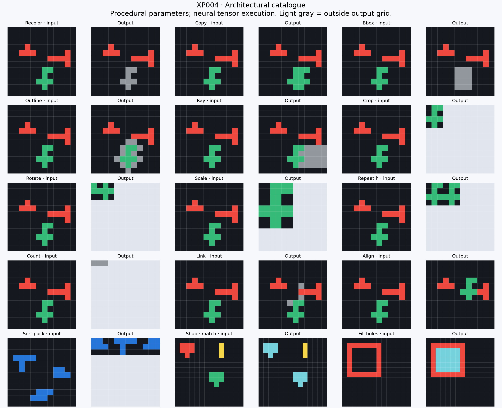
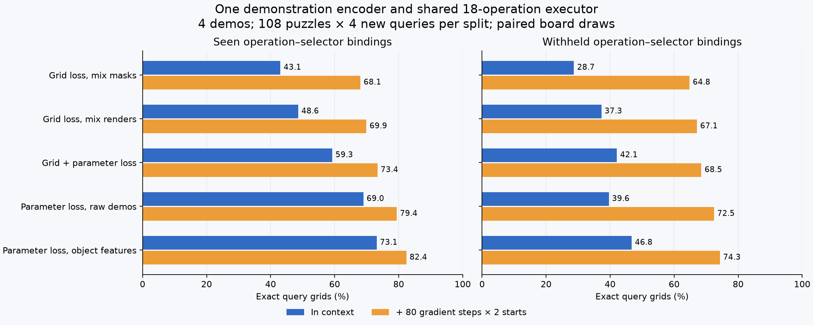
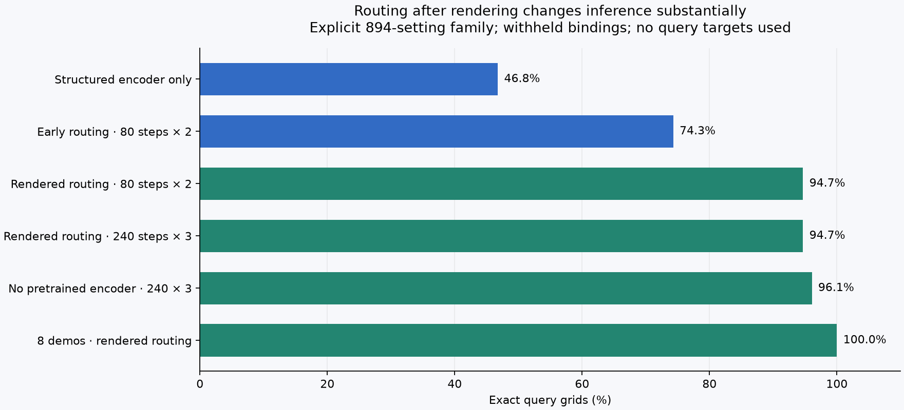

# XP004 — architectural coverage and a shared solver

Date: 2026-10-13. All training data were generated locally from the architectures
below. No ARC examples, language data, pretrained weights, or external datasets
were used. These are **synthetic family experiments, not ARC benchmark scores**.

## What we established

1. The catalogue now has an **18-operation shared executor**, plus three audited
   extensions: sorting/packing objects, translated shape matching, and hole
   filling. All **1,888 independent semantic checks** passed, including tests on
   30×30 canvases. This establishes coverage on the audited inputs, not a proof
   that every ARC instance involving these concepts is represented.
2. One learned demonstration encoder can infer multiple transformation families.
   With procedural parameter supervision it reaches **73.1% exact query grids**
   on seen operation–selector bindings and **46.8% on withheld bindings**. Grid-only
   learning works less well. No generator family ID is supplied at inference.
3. The continuous relaxation matters enormously. With the same trained encoder,
   80 Adam updates and two starts, mixing object masks *before* rendering gives
   **74.3%** on withheld bindings; mixing the rendered alternatives gives
   **94.7%**. The hard transformations available to both are the same.
4. A trained encoder is unnecessary for this finite family if adaptation is
   allowed: **96.1%** from uniform/random routing initialization, four demos,
   three starts of 240 updates. Fresh scene/task draws give **95.8%**; a fresh
   palette-permuted corpus gives **96.1%**. All these runs fit every support grid.
5. **Compositional inference is still weak.** A two-stage model reaches 32.8% on
   seen operation pairs and 11.7% on withheld pairs. Joint demonstration fitting
   helps on a smaller control but does not close the gap.

The strongest result is inference inside an explicit, small architectural
family: **894 discrete parameter settings**, with continuous mixtures during
fitting. It is not discovery of an unrestricted neural transformation or evidence
of ARC-level generality. The finite bank is a substantial prior.



## The executable family

`arcplay/catalogue.py` implements all operations with common tensor machinery.
Inputs are 11-channel boards: ten ARC colors plus X padding. Output dimensions
are represented by a rectangular X region. Hard procedural parameter settings
produce the crisp transformations; softer settings give differentiable mixtures.

| Coverage | Operations and current restrictions |
|---|---|
| Object selection | Largest/smallest, left/right/top/bottom, widest/tallest; eight shared geometric selectors with deterministic positional tie breaks |
| Appearance | Recolor, delete, fill bounding box, outline; five paint choices, colors 5–9 |
| Movement/copying | Translate one cell in a cardinal direction; copy by that offset |
| Relations | L-shaped connector between selected top-left corners; align or stamp source to the right of a destination with a one-cell gap |
| Shape/output geometry | Crop selected object; rotate crop 90/180/270 degrees; reflect crop; enlarge 2×/3×; repeat crop 2×/3× horizontally or vertically |
| Propagation/counting | Directional rays; count connected components and render a colored row |
| Identity | Explicit no-change branch |
| Additional audited modules | Sort objects by area and pack with gaps; recolor objects matching the selected translated shape; fill enclosed background components |

The last three live in `advanced_catalogue.py`; **they are not integrated into the
trained 18-operation solver yet**. Existing XP002/XP003 modules remain available.
This is new coverage plus consolidation, not 21 entirely novel concepts.

Objects come from XP003's same-color, four-connected, 24-step tensor flood
propagation. Every cell seeds a candidate. Inverse-area weighting corrects for
many seeds describing the same object. Pooling, bounding boxes, bilinear tensor
routing, scans, and alpha compositing provide the remaining operations. No scene
instance labels or discrete connected-component routine enter the executor.
Instance labels are used only by the independent semantic audit.

Procedural parameter generation is deliberate: we test architectural
expressibility without requiring random weights to land on a useful task.
Selectors are sharply routed at the object-bank level; the fitted task code
mixes those alternatives. This is not evidence that gradients through a sharply
chosen object's *identity* will be useful everywhere.

The integer oracle in `catalogue_audit.py` and separate controls in
`catalogue_followups.py` implement expected edits independently. Audits cover
rectangles, irregular connected shapes, repeated colors, larger canvases, and
larger object counts. The output must match every cell, including X padding.

## One shared learned solver

The principal solver is:

```text
all demonstration input/output pairs
        ↓ shared CNN + object/spatial features, pooled across demos
48 routing logits: operation, source, destination, color, direction, turn, factor
        ↓ one shared tensor executor
query output
```

The structured encoder has **410,704 trainable parameters**. Its object features
include colors and changes inside each candidate selection; no true rule label
or query output is an inference input. Mean/max pooling across demonstrations
makes their order irrelevant and allows different demonstration counts. The
executor itself supplies the fixed architectural prior.

Training uses a query board distinct from the demonstrations. The main models
were trained on 12×12 scenes containing three separated monochrome objects, with
rectangular and irregular shapes and repeated colors. Training uses a pool of
1,024 scenes, combined with many procedurally sampled transformation settings.
This reuses boards; it is not a million independently generated scenes.

Every operation and selector occurs during training. Approximately one quarter
of operation–selector bindings are withheld using a fixed split. Identity and
count do not use a source selector and have no withheld-binding distinction.
Evaluation uses a disjoint scene pool, **108 puzzles × four query boards per
split**, and four demos per puzzle. All headline rows use paired, deterministic
board draws with no repeated demo/query board indices inside an episode.

Three training losses were compared:

- **Grid only:** cross-entropy on the generated query output.
- **Parameter only:** categorical cross-entropy on the procedural rule's active
  parameter heads. This uses privileged synthetic parameter supervision.
- **Hybrid:** grid loss plus 0.5 times parameter loss.

Grid losses are means over equal-size padded canvases, equivalent to summed
cross-entropy up to a constant learning-rate scale. Parameter loss averages the
active heads. Neither loss includes query answers during evaluation adaptation.

| Model / training loss | Seen, in context | Seen + adaptation | Withheld, in context | Withheld + adaptation |
|---|---:|---:|---:|---:|
| Grid loss, mix masks | 43.1% | 68.1% | 28.7% | 64.8% |
| Grid loss, mix renders | 48.6% | 69.9% | 37.3% | 67.1% |
| Grid + parameter loss | 59.3% | 73.4% | 42.1% | 68.5% |
| Parameter loss, raw demos | 69.0% | 79.4% | 39.6% | 72.5% |
| Parameter loss, object features | 73.1% | 82.4% | 46.8% | 74.3% |

The adaptation columns above all use the original mask-mixture relaxation, 80
updates, two starts, and only demonstration targets. Most models ran 6,000
training updates; the render-mixture grid-only model ran 4,320 with a smaller
batch under its GPU wall-time cap. These are practical comparisons, not equal
compute or exhaustive hyperparameter searches. Main encoder comparisons are one
training seed; fresh inference evaluations below do not constitute independent
training-seed replications.



The raw-demo encoder has 317,008 parameters; its comparison with the structured
encoder is not parameter matched. A separate direct grid decoder combines local
convolutions, directional scans, object pooling, and support cross-attention in
four recurrent blocks. It has 107,150 parameters and trained for 8,000 updates.
It reached **25.5% seen / 20.1% withheld** exact query grids. On a separate
36-puzzle withheld control, full-weight adaptation improved **19.4% → 25.7%**.
Every adaptation update predicted one demonstration from the other demos;
checkpoint selection used that leave-one-demo-out loss. The query answers never
entered training. This is a useful control, not a capacity-matched architecture
comparison or a well-tuned direct solver.

## The gradient-flow finding

The early executor first forms a soft selected-object mask, then calculates its
bounding box and renders it. A mixture of two distant objects may produce a
small, displaced, or otherwise meaningless soft bounding box. This makes useful
routes hard to discover by gradients even when the correct crisp route exists.

The later executor computes each candidate's geometry separately, renders it,
then mixes rendered results. Destination choices are also mixed after rendering
for relational operations. Hard task codes give the same function in both
implementations; tests verify output agreement and task-code derivatives.

For a fixed board, the later computation can be written as

\[
P_z(y_{ij}=c\mid x)=\sum_{r=1}^{894}w_r(z)\,[T_r(x)_{ij}=c],
\qquad
w_r(z)=p_z(r_{\rm op})\prod_{h\in A(r)}p_z(r_h).
\]

Here the active parameter heads depend on the operation. The weights sum to one.
We optimize the 48 logits with demonstration cross-entropy. The public solver
caches the rendered alternatives for the support inputs, so each gradient step
becomes a small tensor contraction. **It is gradient fitting over a finite
primitive bank.** All 894 alternatives are rendered for caching; this is not
unrestricted neural weight fitting and does not avoid finite-family evaluation.

Caching is only an optimization for fixed boards. It cannot propagate gradients
back into a board generator through its stored integer arrays. The uncached
renderer remains available for that path, with piecewise differentiable tensor
routing and tested higher derivatives. The current adaptation loops themselves
are ordinary optimizer loops, not differentiable meta-training loops.

| Inference on withheld bindings | Four-demo exact grids |
|---|---:|
| Trained encoder, no adaptation | 46.8% |
| Early routing: 80 updates × 2 starts | 74.3% |
| Rendered routing: 80 updates × 2 starts | 94.7% |
| Rendered routing: 240 updates × 3 starts | 94.7% |
| No pretrained encoder: 240 updates × 3 starts | 96.1% |

The matched-update render control also uses the early run's Adam learning rate
0.08 and checks the final iterate of each restart, retaining the initial fit.
Early checkpoint selection uses hard-output cross-entropy; the cache uses pixel
mismatch on its crisp renderings. The longer cached controls use learning rate
0.1 and check every 20 updates. Both choose separately for each puzzle using
support targets only. Final predictions use categorical parameter readout and
the shared executor on new query inputs.



With **eight demonstrations**, cached fitting from the trained encoder reaches
**99.3% seen / 100% withheld** on these draws. From an untrained initialization,
fresh scene/task draws reach **96.8% seen / 95.8% withheld** with four demos.
All cached headline runs reconstructed every support grid exactly. Residual query
errors can therefore be consistent-but-wrong rules, not failed support fitting.

As a separate control, exhaustive fitting among the 894 settings reaches
**96.3% seen / 97.9% withheld** with four demos, roughly 99% with eight, and 100%
with sixteen. It selects by support mismatch with a fixed preference for fewer
active parameter heads when tied. It never uses query targets for selection.
These are separate fixed draws from the paired neural comparison. With one demo
accuracy is only 56–60%; even the correct family cannot resolve every ambiguous
puzzle from a single example.

A small gradient audit found zero source-selector gradients in 7/31 applicable
cases at uniform early routing, versus 0/31 after rendering. This is a diagnostic
sample, not a universal theorem. Other dead gradients can remain when a selected
operation makes no edit or an example is uninformative.

## Distribution shifts and composition

The learned encoder initially used palette shortcuts. On a fresh paired corpus
where input colors are independently permuted into colors 1–9, its withheld
accuracy was **13.0%**, or **60.0%** with early demonstration fitting. An additional
3,000 training updates with half the training pool palette-permuted improved those
numbers to **50.0% / 70.8%**. This is a continuation with both more training and
augmentation, not a clean augmentation-only ablation. Cached fitting without a
trained encoder gets **96.1%** on the same fresh palette corpus. Paint parameters
still use colors 5–9: this is not full color equivariance of the family.

In a separate, smaller 54-puzzle-per-condition sweep, the original structured
encoder plus early adaptation scored **68.9% at 20×20** and **61.1% at 30×30**,
with more objects than training. In-context scores were about 30%. These are
limited shape/count/size shifts; input objects remain from the same scene grammar.

A second solver predicts two consecutive task codes and re-extracts regions
between the two board transformations. It trained from scratch on a mixture of
single operations and two-stage compositions. The compositional family combines
four first-stage operations (recolor, move, copy, outline) with six second-stage
operations (crop, rotate, reflect, scale, repeat horizontally/vertically). Six of
the 24 ordered pairs are withheld. Both stages use the same geometric selector.
Procedural parameter supervision is provided during training.

After **3,614 updates** under a 600-second local training cap:

| Two-stage solver evaluation | Exact grids |
|---|---:|
| Single-operation episodes | 43.0% |
| Seen operation pairs | 32.8% |
| Withheld operation pairs | 11.7% |

These rows use 96 puzzles × four queries each. A smaller 24-puzzle control with
40 joint gradient updates improved **33.3% → 59.4%** on seen pairs and
**14.6% → 28.1%** on withheld pairs. Selection used only demonstration loss and
included the initial parameters. The different baseline percentages reflect the
smaller sample. Tests confirm a gradient reaches both stage codes; merely having
nonzero gradients is clearly insufficient.

This model has only 423,040 learned parameters and fewer training episodes than
the single-stage models. The result is not evidence that composition is
impossible. It is evidence that this first two-stage architecture/training setup
does not reliably infer new compositions. Re-extracting objects from soft
intermediate boards is one plausible contributor, consistent with XP003; this
experiment does not isolate it causally.

## What remains outside the represented family

- Multicolor semantic objects, alternative segmentation, touching/occluded
  objects, and reference-dependent grouping are not handled generally.
- Shape matching is translation-only; sort is by area; connectors and alignment
  use specific anchors and conventions. Broader relations need more parameters.
- The single-stage family has only eight geometric selectors and limited action
  parameters. Random continuous scorers from XP003 are not covered by its finite
  cache. Generalizing outside these 894 settings is untested.
- All-cell region seeds scale quadratically in pixel count; 24 flood steps cannot
  represent arbitrary long winding connectivity on a 30×30 board.
- The helper currently expects full-square input canvases. Cropped outputs can
  have X padding. Arbitrary rectangular ARC inputs, collisions at padding edges,
  and general output-shape handling still need work.
- Copy/alignment can overlap or clip objects; connectivity changes then affect
  later stages. The chosen synthetic semantics are not necessarily a particular
  ARC puzzle's semantics.
- No actual ARC evaluation, free-form transformation discovery, or updated
  self-play generator was run in XP004.

## Next architectural direction suggested by the evidence

Keep the shared executor and the independent semantic tests. Add the three
advanced modules to the inferred family, with richer selectors and grouping
priors. For composition, preserve separate object or operation alternatives
longer, rather than merging incompatible boards before the next object
extraction. A beam of neural states or persistent object representations is a
concrete candidate; it has not been tested here.

The learned inference network should then be trained to approximate the good
support-fitting procedure, potentially through unrolled task-code updates or
structured support-error features. There is now a strong within-family fitting
reference to distill and a direct metric for whether amortization approaches it.
The challenge shifts from getting isolated primitives to work to making that
representation/inference procedure scale beyond a small enumerable family.

## Artifacts, reproducibility, and corrections

- Main code: `catalogue.py`, `advanced_catalogue.py`, `unified_solver.py`,
  `cached_solver.py`, `grid_solver.py`, `composed_solver.py` under `arcplay/`.
- Public entry point: `arcplay.solve_catalogue.solve`. It accepts demonstration
  grids and query inputs, with no query-output argument. `checkpoint=None` gives
  untrained routing initialization; a checkpoint plus `steps=0` gives in-context
  inference only. It is a synthetic-family helper, not an official ARC evaluator.
- Configurations: `configs/xp004/`. CPU training can use
  `python -m arcplay.catalogue_experiments --config configs/xp004/code.json --output runs/new-run`.
  Use a unique output directory. `catalogue_modal.py` runs one bounded A10 job
  with the same conservative budget ledger as XP001.
- Figures/tables: `python make_catalogue_report.py` regenerates them from local
  runs. Checkpoints and source snapshots are under gitignored `runs/`.
- Tracked detail: [all measurements](xp004-measurements.json),
  [inventory](xp004-run-inventory.md), [per-family results](xp004-family-table.md),
  and [test output](xp004-tests.txt).

The first pilot preceded sharper positional tie handling. Initial validation
sampled board indices with replacement, allowing occasional support/query index
overlap. Those accuracy tables were superseded, not used for the headline
results. Training checkpoints remain usable. Final evaluation additionally fixes
the episode RNG seed per batch, so differing restart counts do not change the
board draws. Main `*-final` runs, cached controls, and corrected direct-decoder
measurements implement these fixes. Older separate extrapolation/composition
controls are internally evaluated on distinct boards but are not all paired
across conditions.

A probability-conservation test caught invalid soft crop rendering before the
main runs; masked, normalized rendering fixed it. One slow uncached late-routing
validation was interrupted and replaced by the tested equivalent cached path.
Its incomplete run is retained in the inventory. `cached-matched-v2` supersedes
the initial matched-update control by matching learning rate and checkpoint
frequency as well. The annealed grid-only continuation did not improve withheld
in-context accuracy (35.2%); it is retained as a negative result.

Three bounded A10 jobs cost an estimated **$0.58 of worker time**. Including prior
experiments, measured worker estimates total **$0.78**; conservative reservations
including the build/misc allowance total **$11.14 of the $20 budget**. These are
runtime estimates and reservations, not billing invoices. All jobs are complete;
no recurring work was scheduled.
