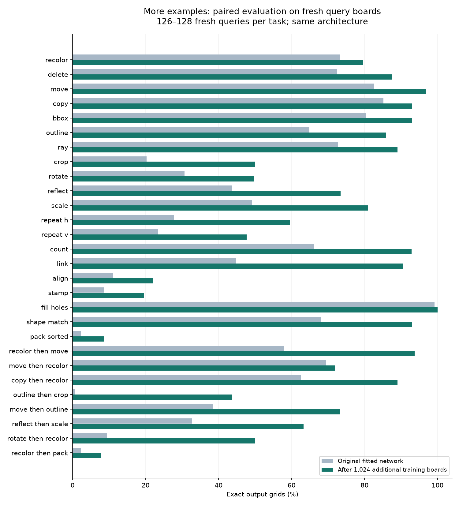
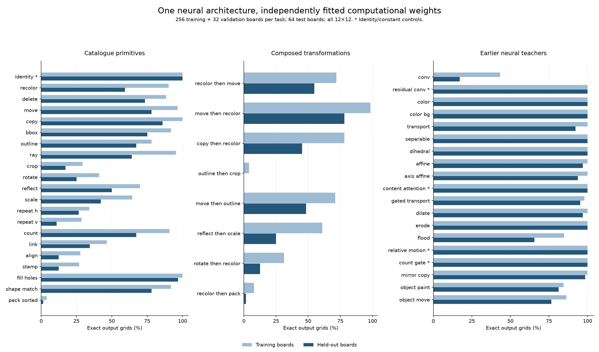
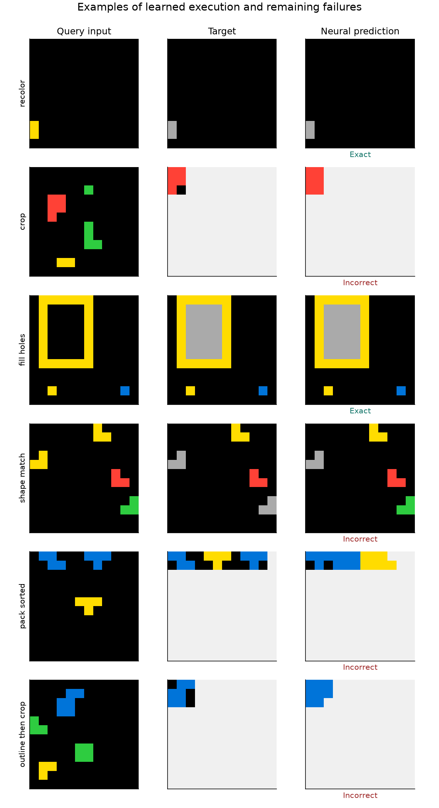

# XP005 — one computational neural architecture across the transformation families

**2026-10-13.** One small neural architecture learns substantial portions of our synthetic transformation suite through ordinary weight optimization, including several compositions. It does **not** yet fit all of it, and inference from a few demonstrations remains weak. This experiment uses only procedural data and freshly initialized networks; no external examples or pretrained weights.

The strongest broad result is **70.6% exact query grids across 20 nonidentity single-stage tasks**, and **61.6% across eight compositions**, after independently fitting the same architecture to each task. A genuinely shared demonstration-conditioned network reaches **10.2% with eight demonstrations**, improving to **23.6% after gradient adaptation of its neural weights**. These are different experimental questions, not interchangeable scores.

[Complete run inventory](xp005-run-inventory.md) · [Data/provenance](xp005-data.md) · [Measurements](xp005-measurements.json) · [All initial task results](xp005-family-table.md) · [All continuation results](xp005-continuation-table.md)

## What “one architecture” means here

`arcplay/neural_transformer.py` implements one board-to-board neural computation. Every task uses the same layers, dimensions, and forward path. Its inputs are grids and, optionally, continuous features inferred from demonstrations. The solver never receives component masks, operation names, selector labels, intermediate target boards, or a catalogue of candidate answers.

The core has **329,272 parameters**, width 48, four residual stages, and four attention heads. Each stage maintains continuous hidden features and combines:

- Learned local 3×3 convolutions and pointwise nonlinear layers.
- Four directional weighted prefix averages plus global averaging, for communication over rows, columns, and the board.
- Content attention with a learned spatial prior. Every head learns a real-valued affine map and an input-dependent displacement field.
- Optional feature modulation by a continuous task vector and cross-attention to demonstration memory.

A final attention layer can copy colors from the input, alongside a learned color head and a trainable identity skip. The input and output canvas has 11 channels: ten colors and X padding. Coordinates include normalized position and inverse canvas dimensions. There is no discrete intermediate execution: argmax is used only when scoring final predictions. Offline teachers do generate hard targets, including hard intermediate targets for the composition dataset.

For output position i and source position j, the spatial attention is

`a_ij = softmax_j(q_i · k_j / sqrt(d) − p ||s_j − (A [r_i; 1] + flow_i)||²)`.

A, flow, the attention projections, convolutions, and color head are actual learned neural weights. This is a continuously parameterized computation, rather than XP004's optimization over 894 rendered alternatives. Spatial precision is capped at 200 in normalized coordinates, an important limitation for resolution transfer.

There are three training modes using this same core:

1. **Independent fitting:** learn a fresh set of neural weights for each fixed transformation. This tests learnability/representation with many examples, not a shared few-shot solver.
2. **In-context solving:** a three-layer pair CNN encodes each demonstration's input and output, producing 16 memory tokens per pair. Symmetric mean/max pooling produces a 128-dimensional task vector. One shared network predicts queries using those features. The total is **414,072 parameters**.
3. **Continuous task-vector fitting:** jointly learn one shared core plus a free 128-dimensional vector for each training task. At test time, freeze the core and optimize a fresh vector on demonstrations. The vector is not a one-hot rule ID or logits over fixed operations. Training task IDs only index the vectors being learned during training.

The multi-stage hidden representation can in principle support compositions, but the experiments only demonstrate the particular learned behaviors below. They do not prove representation of every transformation in our catalogue or arbitrary composition length.

## Supervision and evaluation

All experiments use a grid loss: mean pixel cross-entropy, plus separately normalized cross-entropy on changed cells, plus half-weight cross-entropy on output foreground colors 1–9. The ordinary term penalizes spurious changes; the extra terms reduce domination by background and X. These target-derived weights are used only in the loss, never as model inputs. No parameter or operation-classification loss is used.

Independent fits select the checkpoint with the lowest **validation pixel cross-entropy**. Final test targets never select checkpoints. Metrics include exact grids, cell accuracy, foreground accuracy, changed-cell accuracy, and exact X-mask extent. Exact grids are the headline because almost-correct backgrounds can hide failure.

Most experiments use **12×12 synthetic canvases**, small separated monochrome objects, and a restricted color distribution. The main 48 tasks comprise 21 single-stage tasks, eight compositions, and 19 sampled earlier neural teachers. Each is one particular rule parameterization, not an exhaustive sweep of its family. Four neural teachers degenerate to identity/constant outputs and are explicitly excluded from the nontrivial aggregate.

The shared experiments use a separate bank: 174 training variants across the 29 core/composition families, with 64 training pairs per variant. There are 58 held-out variants, 32 final query boards each, and support examples from a separate pool. Global input hashing keeps all train, validation, and test inputs disjoint, even across tasks. Of the 58, **40 have new active parameterizations**; the other 18 repeat a training parameterization with fresh boards. Distinct parameterizations do not prove distinct semantics. No transformation family is wholly withheld in this experiment.

## Independent weight fitting: broad progress, distinct failures

The initial fit uses 256 training examples, 32 validation examples, and 64 test examples per task. The continuation adds 1,024 training examples and additional optimization, starting from the selected initial weights. It uses 63–64 fresh validation boards and 126–128 fresh query boards per task. Initial weights are scored on these exact same new queries before continuation.

| Task group | Initial test set | Before continuation, fresh queries | After continuation, same fresh queries |
|---|---:|---:|---:|
| 20 single-stage tasks, excluding identity | 48.9% | 51.3% | **70.6%** |
| Eight compositions | 33.2% | 34.2% | **61.6%** |
| 15 nontrivial earlier neural teachers | **87.6%** | — | — |

The continuation changes data quantity, training time, learning rate (0.002→0.001), weight decay (0.0001→0.001), and batch size (16→24); it does not isolate their contributions. These are single-seed task fits. The observed gains should not be read as precise estimates over model initializations.

| Selected transformation | Before | After |
|---|---:|---:|
| Move selected object | 82.7% | **96.9%** |
| Scale selected object | 49.2% | **81.0%** |
| Count objects | 66.1% | **92.9%** |
| Link selected objects | 44.9% | **90.6%** |
| Fill enclosed holes | 99.2% | **100.0%** |
| Match shapes and recolor | 68.0% | **93.0%** |
| Recolor then move | 57.8% | **93.8%** |
| Copy then recolor | 62.5% | **89.1%** |
| Outline then crop | 0.8% | **43.8%** |
| Align objects | 11.0% | **22.0%** |
| Stamp object at another | 8.6% | **19.5%** |
| Sort and pack objects | 2.3% | **8.6%** |
| Recolor then pack | 2.4% | **7.9%** |

Poor packing is already visible on training examples: the selected continued model gets **9.0% train / 8.6% test**, and align gets **38.2% / 22.0%**. Thus the gap is not solely few-shot inference or ordinary overfitting. The current computation and optimization have not learned these tasks reliably. Failure does not distinguish insufficient expressivity, a poor parameterization, and insufficient optimization.

Shape matching was constructed with equal-area, equal-bounding-box distractors, so area and bounding-box shortcuts alone do not explain its high result. The hole dataset includes open controls. The earlier random-neural suite is easier overall and contains four explicitly flagged trivial teachers; a 90.2% aggregate including those controls would overstate useful coverage.

## Shared inference and adaptation

| Method | All 58 held-out variants | 40 new parameterizations |
|---|---:|---:|
| In-context, four demos | 10.4% | 5.2% |
| Wrong-task demos, four | 0.7% | 1.0% |
| In-context, eight demos | 10.2% | 5.1% |
| Eight demos + full-weight adaptation | **23.6%** | **20.5%** |
| Fit continuous task vector, four demos | 17.2% | 15.6% |
| Fit continuous task vector, eight demos | 18.3% | 16.4% |

The in-context network receives 8,371 training updates. It gets 13.6% on fresh queries from trained rule variants. Correct demonstrations help relative to wrong demonstrations, but simply doubling the demonstration count at inference does not improve it. Training used four demonstrations; eight is a count shift as well as additional evidence.

Full-weight adaptation starts separately from the same shared checkpoint for each held-out task. It makes **200 AdamW updates**, learning rate 0.0002, on eight leave-one-out support episodes: predict each demonstration output conditioned on the other seven pairs. It selects weights using this support-only loss, then evaluates all 32 fresh queries with all eight demonstrations. Query answers are never optimizer inputs. The paired comparison improves 38 tasks, ties 12, and worsens eight; no nonfinite stop was encountered.

The continuous-vector model gets **41.2% on fresh queries when supplied its learned training-task vectors** after 13,377 joint updates. That is a useful shared-computation control, but the known vector is privileged information, not an inferred solution. A fresh zero vector scores 1.7% on the 58 evaluation tasks. Fitting a fresh vector for 200 steps raises this to 17.2%/18.3%. Shared decoder weights stay frozen during this fitting.

These comparisons do not isolate architecture: the vector model uses a different spatial initialization, larger batches, and a different number of training updates. They show two workable neural adaptation paths, with full-weight adaptation currently strongest. The relatively low known-vector score also suggests that shared computation/optimization deserves attention alongside the demonstration encoder.

## A controlled optimization result: reflection

Small dense-board controls (8×8, 128 training boards, width 32, three stages) learn global recoloring, movement, and rotation perfectly on 64 query boards. Reflection initially fails. A follow-up fixes the data, optimizer, model shape, and update count and varies only initialization or a flow penalty.

| Final transport initialization / regularization | Exact reflection, seeds 17 / 20 / 23 |
|---|---|
| Identity spatial maps | 0% / 0% / 0% |
| Seeded random orthogonal maps | **100% / 100% / 100%** |
| Identity maps + displacement penalty | 0% / 0% / 0% |

All nine runs use 2,500 updates and the same 64 test boards. The orthogonal initialization leaves one head at identity and initializes the others with random rotations/reflections; every map remains freely trainable. It adds no fixed reflection executor. This is a concrete example where the same function class succeeds or fails depending on gradient optimization's starting point.

A broader eight-task object control does **not** show a consistent improvement: crop drops 17.2%→4.7%, reflect 50.0%→35.9%, rotate rises 25.0%→29.7%, and align rises 12.5%→17.2%. Some runs hit the time cap before the intended matched update count, so this broader check is not uniformly compute-matched. The initializer is promising for the dense control, not established as a better default for all tasks.

## Size transfer and numerical stability

A small read-only control evaluates six original fitted checkpoints on newly generated 12×12 and 30×30 distributions, 24 queries each. Move scores 75%→66.7%, copy 75%→75%, count 83.3%→33.3%, and shape match 66.7%→45.8%. Hole filling drops 95.8%→25%; **all six large-board successes are unchanged controls, and zero of 18 boards requiring edits are exact**. This is not reliable size generalization. The distributions differ, rather than being paired resized grids; normalized spatial precision and larger hole dimensions are plausible contributors, not demonstrated causes.

A lower-learning-rate continuation of the in-context run developed NaN losses by its 1,000-step log. It was stopped and its results discarded; the original finite checkpoint is used above. A CPU continuation remained finite for 824 updates, so the failure was not reproduced. Diagnostics found very large intermediate spatial locations, making the original squared-distance attention bias lose avoidable FP32 precision.

After the measured runs, the code was changed to remove the query-constant squared-location term from attention bias and subtract its per-query maximum. This preserves the intended softmax and gradients; float64 comparisons agree to about 1e-14. On saved activations it reduces attention-output error against float64. It is a precision improvement, **not a verified explanation or cure for the NaN**. Training and inference now guard nonfinite losses/gradients and retain finite support-selected states. Saved source snapshots preserve the implementation used for every reported score; the headline results have not been rerun under the numerical maintenance change.

## What I would pursue next

The experiment supports a common continuous neural computation for many families, including some compositions. It does not support the stronger claim that stacking these ingredients makes every task easy to fit. I would focus next on:

1. **Spatial optimization:** stabilize and normalize learned displacements, and represent spatial precision in pixel-aware units. Reflection and resolution transfer give concrete diagnostics to measure changes against.
2. **Persistent entity representations:** learn reusable object-like feature groups and relations before geometric reconstruction. Packing, alignment, and stamping are the clearest failing targets. This should be learned inside the neural computation, not supplied as catalogue masks.
3. **Train for adaptation:** explicitly train the shared initialization through demonstration-only gradient updates, rather than hoping ordinary in-context training produces a good adaptation landscape. The 10.2%→23.6% gain is motivation, not evidence that a meta-objective will solve it.
4. **Broader rule sampling and depth:** vary rule parameters and composition length during shared training, then evaluate withheld composition structures. Here there are only six training variants per family, and no family-level holdout.

These examples are deliberately selected from saved predictions to illustrate successes and failures; they are not a random accuracy sample. Light gray denotes X padding.

## Reproduction, tests, and cost

Use `arcplay.solve_neural.solve` for the learned in-context checkpoint, with `steps=0` for direct inference or `steps=200` for full-weight adaptation. It accepts only demonstration inputs/outputs and query inputs. See the repository README for usage. Use the data-generation commands in [xp005-data.md](xp005-data.md), configs in `configs/xp005/`, and `python -m arcplay.neural_experiments --config ... --output ...` for local training. The bounded Modal launcher is `neural_modal.py`; it shares the existing budget ledger. `python make_neural_report.py` rebuilds the figures and compact tables from raw runs.

Twelve completed A10 jobs used **5,917 measured worker seconds**, estimated at **$2.47** using the ledger's conservative rate. One canceled continuation has no recovered worker-duration measurement and is not counted as free. Cumulative measured worker estimates across the project are **$3.24**, excluding unmeasured charges. Conservative reservations, including the canceled job, earlier work, and the build/misc allowance, total **$19.425 of the $20 cap**. These are bookkeeping estimates, not a billing invoice. No additional GPU jobs were launched once another reservation would exceed the cap.

All training jobs have finished or been explicitly stopped. Raw datasets, checkpoints, source snapshots, and logs remain in gitignored `runs/`; configs, compact measurements, figures, report, and run inventory are repository artifacts. No official ARC benchmark has been evaluated.

**108 tests pass** after the final maintenance changes. Relevant checks cover independent teacher semantics, split isolation, ambiguous-target rejection, lossless data encoding, gradient flow through learned spatial maps and support features, demonstration-order invariance, small learned transformation generalization, query-independent adaptation, float64 attention equivalence, and recovery from nonfinite support losses/gradients. Figures were rendered and inspected.
